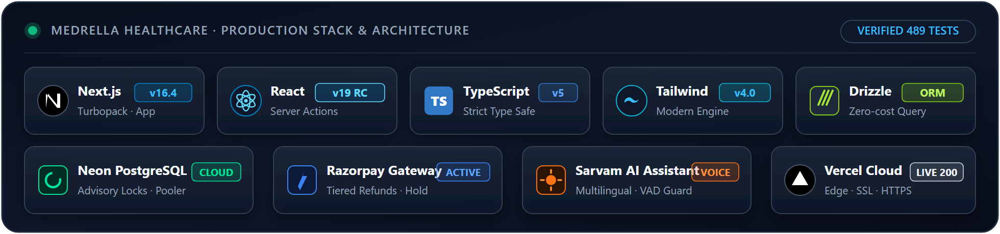

# 🚀 Medrella Healthcare — Production Deployment Guide

  

  
  
  
  

Production deployment guide for **Medrella Healthcare** on **Vercel** backed by **Neon Serverless PostgreSQL**.

🚀 **Live Deployment URL**: [https://medrella-healthcare.vercel.app](https://medrella-healthcare.vercel.app)

---

## 💎 Architecture Overview

> [!NOTE]
> ### 🌐 Cloud Infrastructure
> **Vercel + Neon Serverless** · Next.js 16 App Router hosted on Vercel with edge-compatible serverless functions. Persistent storage powered by Neon Serverless PostgreSQL with Drizzle ORM and strictly additive schema migrations (`0000` to `0006`).

> [!TIP]
> ### 💳 Financial & Notification Integrations
> **Razorpay & Resend/Brevo** · Razorpay Sandbox with 10-minute concurrency holds and automated tiered refunds. Transactional email outbox with fail-safe isolation, Asia/Kolkata (`Asia/Kolkata`, IST = UTC+05:30) precision, and clinical PHI redaction.

> [!IMPORTANT]
> ### 🤖 Sarvam AI Healthcare Assistant
> **Patient Triage & Engagement** · Powered by Sarvam AI (`sarvam-105b-conversations`) with multilingual emergency triage (112 routing) and proactive engagement crons for follow-up and care reminders.

---

## ⚙️ Environment Configuration

Add the following environment variables to your deployment environment (e.g., Vercel Project Settings):

| Category | Environment Variable | Required | Description |
|---|---|:---:|---|
| **Database** | `DATABASE_URL` | Yes | Neon Serverless PostgreSQL connection string |
| **Auth** | `SESSION_SECRET` | Yes | 32+ character random secret for signing JWT session cookies |
| **Application** | `APP_URL` | Yes | Base deployment URL (e.g., `https://medrella-healthcare.vercel.app`) |
| **Admin** | `ADMIN_EMAILS` | Yes | Comma-separated admin emails authorized for `/admin/notifications` |
| **Payments** | `RAZORPAY_KEY_ID` | Yes | Razorpay Sandbox Key ID |
| **Payments** | `RAZORPAY_KEY_SECRET` | Yes | Razorpay Sandbox Key Secret |
| **Payments** | `RAZORPAY_WEBHOOK_SECRET` | Yes | Secret for verifying incoming Razorpay webhooks |
| **Email** | `RESEND_API_KEY` | Optional | Resend API key for transactional emails |
| **Email** | `EMAIL_FROM` | Optional | Sender address (e.g., `appointments@medrella.com`) |
| **AI Agent** | `SARVAM_API_KEY` | Optional | Sarvam AI API key for conversational assistant |
| **Cron Jobs** | `CRON_SECRET` | Yes | Bearer token protecting background cron endpoints |

---

## 🚀 Step-by-Step Deployment Steps

| Step | Action | Command / Procedure |
|:---:|---|---|
| **1** | **Clone Repo** | `git clone https://github.com/atharva1407-sys/Medrella_Healthcare.git` |
| **2** | **Install** | `npm install` |
| **3** | **Database Push** | `npm run db:push` (or run additive migrations `0000` through `0006`) |
| **4** | **Seed Specialists** | `SEED_DOCTOR_PASSWORD="Doctor@123" npm run db:seed` |
| **5** | **Deploy to Vercel** | Link repository to Vercel and set environment variables. |

---

## ⏱️ Background Cron Schedulers

Configure scheduled triggers on [cron-job.org](https://cron-job.org) or Vercel Cron with header `Authorization: Bearer <CRON_SECRET>`:

| Cron Path | Cadence | Function |
|---|:---:|---|
| `/api/cron/notifications` | Every 1 minute (`* * * * *`) | Dispatches due outbox emails and retries failed deliveries. |
| `/api/cron/payments` | Every 2 minutes (`*/2 * * * *`) | Sweeps expired 10-minute seat holds and reconciles payments. |
| `/api/cron/engagement` | Daily (`0 10 * * *`) | Sends post-visit follow-ups and preventive checkup reminders. |

---

## 👤 Pre-Seeded Specialist Accounts

| Doctor | Specialization | Consultation Fee | Email | Password |
|---|---|:---:|---|---|
| **Dr. Rohan Mehta** | Cardiology | ₹800 | `dr.rohan.mehta@medrella.com` | `Doctor@123` |
| **Dr. Priya Nair** | Neurology | ₹900 | `dr.priya.nair@medrella.com` | `Doctor@123` |
| **Dr. Arjun Rao** | Orthopedics | ₹750 | `dr.arjun.rao@medrella.com` | `Doctor@123` |
| **Dr. Sandeep Kulkarni** | General Medicine | ₹500 | `dr.sandeep.kulkarni@medrella.com` | `Doctor@123` |
