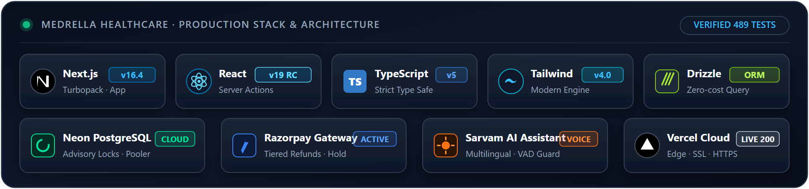

<div align="center">

# 🏥 Medrella Healthcare — Clinical OPD & AI Platform

<p align="center">
  
</p>

<p align="center">
  <a href="https://nextjs.org"></a>
  <a href="https://react.dev"></a>
  <a href="https://www.typescriptlang.org"></a>
  <a href="https://tailwindcss.com"></a>
  <a href="https://orm.drizzle.team"></a>
  <a href="https://neon.tech"></a>
  <a href="https://razorpay.com"></a>
  <a href="https://www.sarvam.ai"></a>
  <a href="https://medrella-healthcare.vercel.app"></a>
</p>

Full-stack outpatient clinical management platform built for **Pearl Thoughts (Tasks 1–6)**, designed for **Medrella Healthcare, Ruby Hall, Pune, Maharashtra**.

---

## 🌐 Quick Links & Live Demonstrations

| Destination | Link | Description |
|---|---|---|
| 🚀 **Live Production App** | [medrella-healthcare.vercel.app](https://medrella-healthcare.vercel.app) | Live deployment on Vercel |
| 📦 **Deployment Repository** | [github.com/atharva1407-sys/Medrella_Healthcare](https://github.com/atharva1407-sys/Medrella_Healthcare) | Standalone deployment repository |
| 🤖 **AI Assistant (Patients & Doctors)** | Floating chat on patient & doctor dashboards | Multilingual voice & text, confirmed booking/cancel/reschedule, payments & prescriptions |
| 📬 **Admin DLQ Outbox** | [/admin/notifications](https://medrella-healthcare.vercel.app/admin/notifications) | Dead-letter queue & email dispatch monitor |
| 📊 **Live OPD Waiting Queue** | [/queue](https://medrella-healthcare.vercel.app/queue) | Real-time triage with obstetric override |

</div>

---

## 💎 Project Highlights

> [!NOTE]
> ### 🏥 Clinical OPD Operations & Live Queue
> **Real-Time Patient Flow** · Token-by-token queue with triage badges (`Emergency`, `In consult`, `Waiting`), obstetric pre-eclampsia override banners (BP 168/110), reception desk walk-in tokens, and physician encounters with SOAP notes, ICD-10 diagnosis picker, and live vitals tracking.

> [!TIP]
> ### 📅 Elastic & Multi-Session Scheduling
> **Dynamic Clinic Hours** · Flexible Morning & Evening OPD shifts repeating weekly, on specific monthly dates (1–31), or one-date-only with Stream & Wave formats (1–20 patients/slot). Features **Elastic Scheduling** to expand/shrink session hours with active bookings without dropping patients.

> [!IMPORTANT]
> ### 💳 Razorpay Payments & Automated Tiered Refunds
> **Zero-Risk Transactions** · 10-minute concurrency seat holds, server-side HMAC-SHA256 signature verification, tamper-proof database fee authority, and automated tiered cancellation refunds (≥24h: 100%, 2h–24h: 50%, <2h: 0%, Doctor Cancel: 100%).

> [!NOTE]
> ### 🤖 Sarvam AI Healthcare Assistant & Reliable Outbox
> **Safe Patient-in-the-Loop AI** · Powered by Sarvam AI (`sarvam-105b-conversations`) for patients and doctors, with text and hands-free voice, English/Hindi/Marathi/Hinglish emergency triage (112 routing), and real booking, cancel, reschedule and payment actions that always need an explicit Confirm. Backed by Brevo & Resend transactional email outbox with Asia/Kolkata (`Asia/Kolkata`, IST = UTC+05:30) precision and clinical PHI redaction.

---

## 📁 Task-by-Task Repository Map

Every task folder is self-contained and independently runnable with its own automated verification tests:

| Module | Task Name | Key Deliverables & Capabilities | Tests |
|:---:|---|---|:---:|
| [`Task_1`](Task_1) | **ER Diagram & Architecture** | Relational outpatient domain model (`User` → `Patient` → `Doctor` → `Availability` → `Appointment`), architecture walkthrough video (`ER_Diagram.mp4`), and Next.js Turbopack baseline. | Lint Pass |
| [`Task_2`](Task_2) | **Medrella App Core** | Full-stack clinical management: Live Queue (`/queue`), Reception Desk (`/reception`), Encounters with SOAP notes & vitals (`/encounters`), PBKDF2 auth (600,000 iterations), and Radix UI design system. | **31** Pass |
| [`Task_3`](Task_3) | **Feedback & Scheduling** | Review feedback implementation: Multi-session shifts (weekly, monthly 1–31, one-date), Stream & Wave parity (1–20 patients/slot), atomic 1-click slot rescheduling, and doctor clinical leave guards. | **198** Pass |
| [`Task_4`](Task_4) | **Payments & Refunds** | Razorpay Test Mode integration, 10-min seat holds (`PENDING_PAYMENT`), HMAC-SHA256 signature verification, idempotent webhook processing, late-payment reconciliation, and tiered refunds. | **270** Pass |
| [`Task_5`](Task_5) | **Reliable Notifications** | Fail-safe transactional email outbox (Brevo/Resend), Asia/Kolkata (`Asia/Kolkata`, IST = UTC+05:30) precision, pre-send status recheck, clinical PHI redaction, patient settings (`/settings`), and admin DLQ dashboard (`/admin/notifications`). | **299** Pass |
| [`Task_6`](Task_6) | **Healthcare Agent** | Sarvam AI assistant for patients and doctors (text + voice, multilingual), confirmed booking / cancel / reschedule with in-chat payment, prescriptions, emergency triage (112 advice), proactive engagement cron jobs, and elastic session scheduling. | **489** Pass |

---

## 🛠️ Tech Stack & Architecture

| Layer | Technologies |
|---|---|
| **Framework & UI** | Next.js 16.4 (App Router), React 19, TypeScript 5, Tailwind CSS 4, Radix UI Primitives, Lucide Icons |
| **Database & ORM** | PostgreSQL (Neon Serverless), Drizzle ORM, Strictly Additive Migrations (`0000` to `0007`) |
| **Authentication** | PBKDF2 (600,000 iterations), Stateless signed HTTP-only JWT cookies, Password-confirmed deletion |
| **Payments & Gateways** | Razorpay (Test Mode Sandbox), Provider Abstraction (`RazorpayProvider`, `MockProvider`) |
| **Email & Outbox** | Transactional Outbox Pattern, Brevo API, Resend API, ConsoleChannel fallback, Asia/Kolkata (`Asia/Kolkata`, IST = UTC+05:30) scheduler |
| **AI Assistant** | Sarvam AI (`sarvam-105b-conversations`), Multilingual (EN, HI, MR, Hinglish), Role-scoped Zod Tool Calling, Signed Confirmations, Voice (STT + browser TTS) |

---

## 🏃 Quickstart: Running Any Task

Each task folder (`Task_1` to `Task_6`) runs independently:

```bash
cd Task_6               # Or Task_1, Task_2, Task_3, Task_4, Task_5
npm install
cp .env.example .env.local
npm run dev             # Starts dev server on http://localhost:3000
npm test                # Runs self-contained automated tests (zero network needed)
```

> [!TIP]
> **Zero-Database Offline Mode**: Tasks 2 through 6 include an in-memory repository fallback. Set `DATABASE_URL="disabled-for-local-test"` and `USE_MOCK_PAYMENTS=true` to test all features with pre-seeded specialists and simulated payments without needing PostgreSQL.

---

## 👤 Demo Accounts & Test Credentials

| Role | Email | Password | Details |
|---|---|---|---|
| **Cardiology** | `dr.rohan.mehta@medrella.com` | `Doctor@123` | Fee: ₹800 · Morning & Evening OPD |
| **Neurology** | `dr.priya.nair@medrella.com` | `Doctor@123` | Fee: ₹900 · Wave & Stream sessions |
| **Orthopedics** | `dr.arjun.rao@medrella.com` | `Doctor@123` | Fee: ₹750 · Sports medicine & trauma |
| **General Medicine** | `dr.sandeep.kulkarni@medrella.com` | `Doctor@123` | Fee: ₹500 · Walk-in and general OPD |
| **Patient Demo** | *Self-register at `/register`* | *Custom* | Instant access to Assistant & Booking |
| **Admin Outbox** | `admin@rubyhall.com` | *(Configured via `ADMIN_EMAILS`)* | Access to `/admin/notifications` |

### Razorpay Test Payment Instruments
* **Test Cards**: `4718 6091 0820 4366` (Visa) or `5267 3181 8797 5449` (Mastercard) · Expiry: `12/28` · CVV: `123`
* **Test UPI ID**: `success@razorpay` *(instant success simulation)*

---

## 📄 License & Attribution

Developed for the **Pearl Thoughts** Full Stack Development Assessment by **Atharva Mandlik** for **Medrella Healthcare, Ruby Hall, Pune, Maharashtra**.
