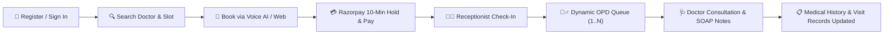

<div align="center">

# 🏥 Medrella Healthcare

### Enterprise Outpatient Department (OPD) Orchestration, Multilingual Voice AI & Clinical Health Records

*Pearl Thoughts Full-Stack Engineering Assessment · Tasks 1 through 9*
*Designed for Ruby Hall Clinic, Pune*

[](https://medrella-healthcare.vercel.app)
[](https://github.com/atharva1407-sys/Medrella_Healthcare)
[](https://github.com/atharva1407-sys/Pearl_Thoughts_Atharva-Mandlik)

<p align="center">
  
</p>

<p align="center">
  
  
  
  
  
  
  
  
</p>

</div>

---

## 📌 Project Overview

**Medrella Healthcare** is an enterprise-grade hospital outpatient platform engineered incrementally across **9 comprehensive milestones**. It combines high-throughput clinical operations, collision-free wave/stream OPD scheduling, dynamic physical queue management, a front-desk receptionist suite, hands-free multilingual AI assistance, and longitudinal patient health records.

### 🛡️ Core Engineering Safeguards
* **Zero Double-Bookings**: PostgreSQL session advisory locks and atomic Compare-And-Swap (CAS) state machines prevent race conditions under burst concurrency.
* **10-Minute Seat Holds & Tiered Refunds**: Real Razorpay integration with automated idempotent refunds (100% $\ge$ 24h notice, 50% 2–24h notice, 0% $<$ 2h notice).
* **Guaranteed Outbox Delivery**: Transactional email outbox pattern with Brevo/Resend integration, background workers, and admin dead-letter recovery.
* **Clinical Voice AI with Hard Safety Rails**: Hands-free Voice Activity Detection (VAD) across English, Hindi, Marathi, and Hinglish. Signed, single-use confirmation tokens for sensitive actions, and instant 112 emergency routing for acute symptoms.
* **Zero-Downtime Data Architecture**: Backward-compatible additive migrations (`0000` through `0010`) pairing serverless PostgreSQL with an in-memory test store.

---

## 📋 Task Matrix: Chronological Development (Tasks 1 – 9)

Each directory in this repository represents an autonomous, runnable application reflecting the cumulative features developed up to that phase.

| Task | Title & Clinical Domain | Key Features & Architecture Delivered | Security & Data Integrity | Checks |
|:---:|---|---|---|:---:|
| [**Task 1**](Task_1) | **Relational Schema & System Baseline** | • Comprehensive relational ER model for multi-specialty OPD<br>• Core domain entities: Users, Doctors, Patients, Sessions, Appointments<br>• Entity-Relationship diagram, video walkthrough, and Next.js starter | • Normalized PostgreSQL schema<br>• Foreign key cascade rules<br>• Domain type definitions | *Spec* |
| [**Task 2**](Task_2) | **Core Clinical OPD Application** | • Live patient waiting queue with clinical triage severity badges<br>• Obstetric & emergency priority queue override<br>• Doctor clinical encounters: SOAP clinical notes, ICD-10 diagnosis, vitals<br>• Walk-in registration with physical token allocation | • PBKDF2 password hashing (600k iter)<br>• HTTP-only encrypted session cookies<br>• Strict role-based page protection | **17** |
| [**Task 3**](Task_3) | **Advanced Wave & Stream Scheduling** | • Multiple doctor sessions per day (Morning OPD & Evening OPD)<br>• Weekly recurrence, monthly date-of-month, and one-off dates<br>• Stream (1:1) and Wave scheduling (1–20 seats per block)<br>• Atomic doctor leave blocking and one-click slot rescheduling | • Postgres advisory locks on slot booking<br>• 5 failed attempts / 15-min login rate limiter<br>• Doctor-patient tenant isolation | **205** |
| [**Task 4**](Task_4) | **Payment Gateway & Tiered Refund Policies** | • Razorpay checkout integration with 10-minute temporary seat holds<br>• Automated release worker for expired pending payments<br>• Automated cancellation refunds based on clinical notice hours<br>• Printable payment vouchers & GST-compliant receipt generation | • Cryptographic HMAC-SHA256 signature verification<br>• Webhook idempotency keys<br>• Double-refund CAS protection | **305** |
| [**Task 5**](Task_5) | **Transactional Outbox & Notifications** | • Asynchronous transactional notification outbox pattern<br>• Brevo & Resend dual-provider delivery pipeline with exponential backoff<br>• Automated 24h & 2h appointment reminders in IST timezone<br>• Admin dead-letter queue dashboard with one-click retry | • Strict PII redaction from email payloads<br>• Cryptographic one-click unsubscribe tokens<br>• Fail-closed delivery guards | **417** |
| [**Task 6**](Task_6) | **Conversational Voice AI & Elastic Hours** | • Multilingual conversational agent (English, Hindi, Marathi, Hinglish)<br>• Web Audio API Voice Activity Detection (VAD) & barge-in interruption<br>• Signed single-use confirmation cards before executing appointments<br>• Elastic session adjustment: stretch/shrink hours without stranding patients<br>• Client-side persistent chat history with automatic sign-out purging | • 112 emergency routing for acute symptoms<br>• Prompt injection & prompt leak guards<br>• Server-side re-verification of slot capacity at confirmation | **794** |
| [**Task 7**](Task_7) | **OPD Check-in & Dynamic Queue Engine** | • Doctor/staff barcode & walk-in check-in engine<br>• Dynamic contiguous queue numbering ($1 \dots N$) with permanent token IDs<br>• Accurate remaining wait time estimation adapting to consultation speed<br>• Full clinical lifecycle: `BOOKED` → `CHECKED_IN` → `IN_CONSULTATION` → `COMPLETED`<br>• Privacy-preserving patient dashboard with live queue progress | • Atomic check-in CAS guards preventing double check-in<br>• Strict date boundary guards (today only)<br>• Automatic repositioning when waiting patients cancel | **840** |
| [**Task 8**](Task_8) | **Doctor-Assigned Receptionists & Unavailable Flow** | • Dedicated receptionist portal (`/login?portal=reception`)<br>• Doctors manage front-desk staff via `/doctor/reception-team`<br>• Receptionists see queues only for doctors who assigned them<br>• "Unavailable" action: removes patient, closes queue gap, and opens reschedule modal<br>• Solo-doctor fallback mode (retains front-desk controls if no receptionist)<br>• Migration `0009_receptionist_assignments` & Next.js 16.4.6 security patch | • Strict role split: Receptionist checks in / handles arrivals; only Doctor calls/completes<br>• Dynamic server-side assignment verification on every request<br>• Atomic queue repositioning on arrival retry | **869** |
| [**Task 9**](Task_9) | **Patient Longitudinal Health Record (LHR)** | • Comprehensive patient medical profile: Blood group, height, weight, allergies (with severity & reaction), chronic conditions, current meds, past surgeries, family history<br>• Versioned audit trail (`patient_medical_history_log`): tracks who, when, and exact before/after field diffs<br>• Optimistic concurrency control (`expectedVersion`): blocks stale concurrent overwrites<br>• Chronological visit history across hospital clinics with doctor clinical notes & prescriptions<br>• Doctor `/doctor/patients` roster & patient dashboard separating upcoming, completed, and missed visits<br>• Migration `0010_patient_medical_history` | • Server-enforced clinical relationship gate (only treating doctors can view/edit records)<br>• Receptionist role strictly barred from medical records<br>• Cascade deletion cleans profiles on account purge | **891** |

---

## 🎬 2-Minute Interactive Demo Walkthrough

Experience the complete application live on **[medrella-healthcare.vercel.app](https://medrella-healthcare.vercel.app)**:



1. **Explore Specialists**: View Ruby Hall Clinic's 8 department specialists with real-time next-available slot markers.
2. **Register as Patient**: Sign up at `/signup` with any email and an 8+ character password.
3. **Conversational Booking**:
   - Open the floating assistant widget (bottom right).
   - Type or speak: *"Book Dr. Rohan Mehta tomorrow morning"*.
   - A cryptographic **Confirm Card** appears—verify slot details and press **Confirm**.
4. **Razorpay Sandbox Payment**:
   - Test Card: `4718 6091 0820 4366`, Expiry: Any future date, CVV: `123`.
   - Test UPI: `success@razorpay`.
5. **Front-Desk Check-In & Queue**:
   - Sign in as Doctor `rohan.mehta@medrella.com` (password configured or demo mode).
   - Go to **Reception Team**, add receptionist `pooja@medrella.com`.
   - Sign in through the **Receptionist** portal (`/login?portal=reception`) to see the assigned queue.
   - Click **Check In** to place the patient in the active queue. Test **Unavailable** to observe contiguous gap-closing.
6. **Consultation & Medical Records (Task 9)**:
   - As Doctor, **Call** the patient and **Complete** consultation.
   - Enter diagnosis, symptoms, and clinical advice.
   - Open **My Patients** (`/doctor/patients`) to inspect the patient's full longitudinal health history.
   - Log back in as Patient to see completed consultation notes and the immutable update audit log.

---

## 🛠️ Tech Stack & Architecture

```
┌────────────────────────────────────────────────────────────────────────┐
│                        Next.js 16.4.6 App Router                       │
│      React 19 Server Components · Server Actions · Client Interactivity │
└──────────────┬──────────────────────────┬──────────────────────────────┘
               │                          │
        ┌──────▼──────┐            ┌──────▼──────┐
        │  Sarvam AI  │            │  Razorpay   │
        │ Voice & LLM │            │ Payment API │
        └──────┬──────┘            └──────┬──────┘
               │                          │
┌──────────────▼──────────────────────────▼──────────────────────────────┐
│                  Application Repository & Business Logic                │
│       Advisory Locks · CAS State Machines · Outbox Dispatcher          │
└──────────────┬──────────────────────────┬──────────────────────────────┘
               │                          │
        ┌──────▼──────┐            ┌──────▼──────┐
        │    Brevo    │            │ Drizzle ORM │
        │ Email Outbox│            │ Neon Pg SQL │
        └─────────────┘            └─────────────┘
```

* **Frontend**: Next.js 16.4.6 (App Router), React 19, Tailwind CSS, Lucide Icons, Radix UI.
* **Backend & Validation**: Next.js Server Actions, Route Handlers, Zod schema validation.
* **Database & ORM**: PostgreSQL via Neon Serverless, Drizzle ORM, Drizzle Kit Migrations.
* **Speech & AI**: Sarvam AI Conversational Engine, Browser Web Audio API, Custom Voice Activity Detection (VAD).
* **Payments**: Razorpay Payment Gateway, Webhooks, Tiered Cancellation Engine.
* **Notifications**: Transactional Outbox Pattern, Brevo (Sendinblue), Resend API, ICS Calendar Invites.

---

## 🚀 Local Development Quickstart

You can test any task locally without requiring an external PostgreSQL instance or third-party API credentials:

```bash
# 1. Navigate to the desired task directory (e.g., Task_9)
cd Task_9

# 2. Install dependencies
npm install

# 3. Configure environment variables for mock / in-memory mode
cp .env.example .env.local
```

Set the following in `.env.local` for instant in-memory execution:
```env
DATABASE_URL="disabled"
USE_MOCK_PAYMENTS="true"
ENABLE_SEED_DATA="true"
SEED_DOCTOR_PASSWORD="Password123!"
```

```bash
# 4. Start the Next.js development server
npm run dev

# 5. Run the complete automated test suite (891 checks across 17 suites)
npm test
```

---

## 📦 Repository Ecosystem

| Repository | Scope & Purpose | Link |
|---|---|:---:|
| **Task Repository** (`Pearl_Thoughts_Atharva-Mandlik`) | Monorepo containing full incremental development history across Tasks 1 to 9. | [GitHub](https://github.com/atharva1407-sys/Pearl_Thoughts_Atharva-Mandlik) |
| **Deployment Repository** (`Medrella_Healthcare`) | Production-ready root deployment application with automated GitHub Actions CI/CD. | [GitHub](https://github.com/atharva1407-sys/Medrella_Healthcare) |

---

<div align="center">

**Built with precision by Atharva Mandlik**  
*Full Stack Developer · Pearl Thoughts Assessment*  
*Medrella Healthcare for Ruby Hall Clinic, Pune*

</div>
