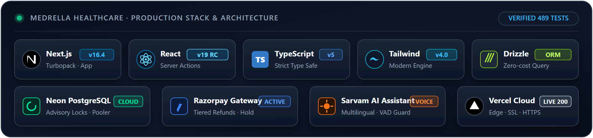

<div align="center">

# Task 6: Conversational Healthcare Agent & Elastic Scheduling

<p align="center">
  
</p>

<p align="center">
  <a href="https://nextjs.org"></a>
  <a href="https://www.sarvam.ai"></a>
  <a href="https://razorpay.com"></a>
  <a href="https://neon.tech"></a>
</p>

</div>

Full-stack clinical management platform featuring a **Conversational Healthcare Agent**, **Proactive Engagement Jobs**, and **Elastic Scheduling** for **Pearl Thoughts (Task 6)**.

---

## 💎 Task 6 Core Innovations

> [!NOTE]
> ### 🤖 Sarvam AI Conversational Assistant (`/patient/assistant`)
> **Patient-in-the-Loop Triage** · Powered by Sarvam AI (`sarvam-105b-conversations`). Pre-model safety checks detect emergencies in **English, Hindi, and Marathi** (e.g., chest pain, severe bleeding, shortness of breath, self-harm) and immediately respond with fixed medical guidance to call **112**, never sending the prompt to the LLM.

> [!TIP]
> ### 📅 Elastic Session Scheduling (`src/lib/elastic-schedule.ts`)
> **Dynamic Clinic Hours** · Doctors can stretch or shrink existing OPD sessions (Weekly Shifts → edit) **even when appointments are booked**. Live preview calculates added or removed slots. If hours shrink past booked patients, doctors choose: **move to nearest free slot** (default), **cancel and refund**, or **keep booked**.

> [!IMPORTANT]
> ### 📬 Proactive Patient Engagement Jobs (`/api/cron/engagement`)
> **Care Follow-Up & Retention** · Automated cron jobs run daily: post-visit follow-ups sent after consultation completion, preventive care reminders (90 days), and patient re-engagement nudges (180 days). Promotional messages are strictly gated by patient opt-in preferences.

---

## 🧭 Healthcare Agent Pipeline & Safety

| Step | Component | Safety & Privacy Implementation |
|:---:|---|---|
| **1** | **Patient Request** | Signed-in patients only; rate-limited to 20 messages per 10 minutes. |
| **2** | **Emergency Filter** | English, Hindi, and Marathi regex/keyword check. Routes to 112 instantly without contacting the AI model. |
| **3** | **Model Tool Calling** | Model receives system prompt with read-only and proposal tools. Direct database access is blocked. |
| **4** | **Booking Hand-off** | Agent returns an **interactive UI proposal card** linking to checkout with the slot pre-selected. Patients review and pay there. |
| **5** | **Audit Logging** | Tool invocations and errors logged in `agent_events` with parameters, but **never raw user message text**. |

### Agent Tool Manifest

| Tool Name | Parameters | Effect & Safe Return |
|---|---|---|
| `search_doctors` | `query`, `department` | Scoped lookup returning doctor name, department, and consultation fee. |
| `get_open_slots` | `doctorId`, `startDate`, `endDate` | Returns open consultation slots in IST for the specialist. |
| `list_my_appointments` | `status` | Read-only listing of the signed-in patient's upcoming visits. |
| `propose_booking` | `doctorId`, `date`, `time` | Validates slot availability and outputs an interactive booking card. |
| `propose_manage_appointment` | `appointmentId` | Returns a management card displaying the live refund preview before cancellation. |

---

## 🔄 Elastic Scheduling Resolution Options

When editing session hours that affect booked patients, the system requires an explicit clinical resolution:

| Resolution Strategy | Clinical Behavior | Notification & Refund |
|---|---|---|
| **Move to Nearest Slot** *(Default)* | Re-assigns booked patients to the closest available slot within the new session hours. | Patients are notified of their new time via email outbox. |
| **Cancel & Refund** | Cancels affected bookings and triggers an automated 100% full refund via the payment gateway. | Cancellation and refund confirmation emails are queued immediately. |
| **Keep as Booked** | Preserves existing appointments at their original times even if outside standard shift bounds. | Existing booking confirmation remains unchanged. |

---

## 🛠️ Verification & Test Suite

```bash
cd Task_6
npm install
cp .env.example .env.local
npm run db:migrate-0005    # adds agent audit table
npm run db:migrate-0006    # adds flexible scheduling recurrence
npm run dev               # Starts dev server on http://localhost:3000
npm test                  # Runs 390 automated tests (zero network needed)
```

| Test Suite | Tests | Result | Verification Scope |
|---|:---:|:---:|---|
| **`src/test-suite.ts`** | **115** | **Passed** | Clinical rules, wave/stream capacity, token sequences, and double-booking guard. |
| **`src/test-payment-hardening.ts`** | **72** | **Passed** | Razorpay webhooks, signature verification, seat holds, and tiered refund engine. |
| **`src/test-notifications.ts`** | **81** | **Passed** | Outbox deduplication, IST midnight calculations, PHI redaction, and DLQ retries. |
| **`src/test-agent.ts`** | **72** | **Passed** | Sarvam AI tool calling, safety checks, multilingual emergency triage, and crons. |
| **Timezone & Recurrence** | **50** | **Passed** | Recurrence rules (dates 1–31, one-date-only) across multiple client timezones. |
| **Total Test Suite** | **390 Passed** | **0 Failed** | **100% Deterministic Verification** |
